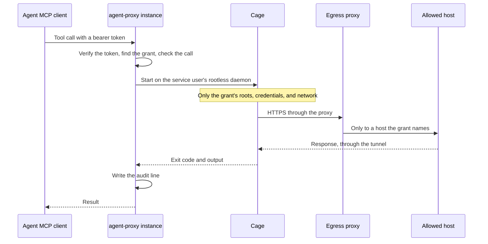

# agent-proxy

agent-proxy is a per-agent MCP proxy. An agent calls a tool with a token minted for one scope, and
the proxy runs the scoped, credentialed action in a short-lived container. That container holds only
what the scope grants the action: files, domains, credentials, and plain environment variables. The
credentials stay in the container, so the agent never holds one.

## Why

An agent that needs a credential usually gets the credential. It then holds all of it, because a
credential the agent can read cannot be narrowed to particular operations. A tool surface tied to
one service serves nothing else. And a tool such as git runs code that a repository controls, such
as its hooks, with every reach the tool has. [The architecture](docs/architecture.md) gives how
agent-proxy answers each of these problems.

## How a call works

The agent's MCP client calls a tool with its token. The instance checks the call against the token's
scope, runs the action in a cage, and writes the audit line before it returns the result.

[The call path](docs/architecture.md#the-call-path) gives each step.

## What it needs

The host needs Docker Engine with rootless support, systemd, and the other packages that
[Requirements](docs/deployment.md#requirements) lists. Provisioning then sets up three parts around
each agent's instance:

- **The service user**, `agentproxy-<agent>`, runs the instance and its cages, so the agent cannot
  read a cage's credentials, and a compromised instance or cage reaches one agent's tree, not the
  host.
- **Its rootless Docker daemon** starts every container on a socket the agent cannot reach, so the
  agent cannot start a container that skips its grants, and container root maps to the service user,
  never to the host's root.
- **The ACLs on the agent's tree** let the instance and the agent read and write each other's files
  there. Only the agent and the service user may traverse the agent's home, and provisioning warns
  when anyone else can, as [The agent's tree](docs/architecture.md#the-agents-tree) gives.

[Why each part is needed](docs/deployment.md#why-each-part-is-needed) gives what breaks without each
part. [The deployment guide](docs/deployment.md) takes the operator through provisioning, the first
start, and the self-check.

## Plugins

Each plugin is an image whose actions run in a cage. The repository holds these plugins:

| Plugin                                           | What it runs                                  |
| ------------------------------------------------ | --------------------------------------------- |
| [git](plugins/git/README.md)                     | git and git LFS                               |
| [github](plugins/github/README.md)               | gh, the GitHub CLI                            |
| [hcp-terraform](plugins/hcp-terraform/README.md) | Scripts that read HCP Terraform runs and logs |

[Writing a plugin](docs/writing-a-plugin.md) tells a plugin author how to add one.

## Documentation

- [`docs/architecture.md`](docs/architecture.md) describes what is built and why, and cites the code
  by path.
- [`docs/deployment.md`](docs/deployment.md) tells the operator how to provision, start, check, tear
  down, and upgrade one agent's instance, and why each part of the setup is needed.
- [`docs/reference.md`](docs/reference.md) gives the config file's fields, the operator command, and
  the results and refusals of a call.
- [`docs/acceptance-checks.md`](docs/acceptance-checks.md) holds the checks the operator runs by
  hand on a deployed instance.
- [`docs/writing-a-plugin.md`](docs/writing-a-plugin.md) tells a plugin author what the image holds,
  and how to write and check its manifest.
- [`examples/instance.yaml`](examples/instance.yaml) is a sample instance config.
- [`CONTRIBUTING.md`](CONTRIBUTING.md) tells a contributor how a change lands, how to set up and
  check it, and the rules for tests and pins.
- [`CHANGELOG.md`](CHANGELOG.md) gives what each release brings.

## Licence

agent-proxy is under the MIT licence, in [`LICENSE`](LICENSE). The published images also ship
third-party software under its own licences, as [`THIRD-PARTY-NOTICES.md`](THIRD-PARTY-NOTICES.md)
gives.
